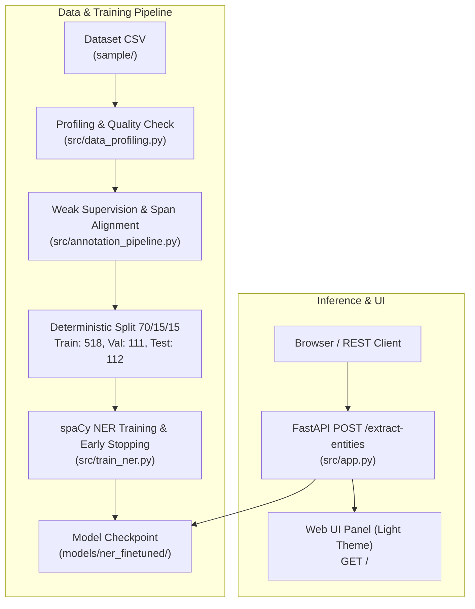

# Article Named-Entity Recognition (NER) Service

Layanan ekstraksi entitas bernama (`PERSON`, `ORG`, `GPE`, `DATE`, `EVENT`) dari artikel berita berbasis *fine-tuned* pipeline spaCy dengan antarmuka web modern dan REST API berbasis FastAPI.

---

## 1. Arsitektur Layanan



---

## 2. Panduan Menjalankan Sistem

### Prasyarat:
- Python 3.10+
- Dependensi: `pip install -r requirements.txt`

### Tahapan Eksekusi:
```bash
# 1. Profiling Dataset
python src/data_profiling.py

# 2. Pipeline Anotasi & Data Splitting (70/15/15)
python src/annotation_pipeline.py

# 3. Pelatihan Model & Evaluasi
python src/train_ner.py

# 4. Menjalankan Automated Tests (22 skenario)
python tests/test_api.py
# atau: python -m pytest tests/test_api.py -v

# 5. Menjalankan Aplikasi Web & REST API
python src/app.py
```
Akses di browser:
- **Web UI**: [http://localhost:8000/](http://localhost:8000/)
- **Swagger Docs**: [http://localhost:8000/docs](http://localhost:8000/docs)

---

## 3. Penyiapan Dataset

Sesuai aturan repositori (*.gitignore*), file CSV mentah tidak di-commit ke Git. Anda dapat meletakkan file CSV sampel di:
- Folder lokal: `dataset/*.csv` (Otomatis diabaikan git)
- Variabel lingkungan: `$env:NER_DATA_DIR = "D:\path\to\csv_folder"` (PowerShell) atau `export NER_DATA_DIR="..."` (Linux/macOS)
- Path bawaan: `use_cases/pnm_study_case/sample/*.csv`

---

## 4. Dokumentasi REST API

### `POST /extract-entities`

#### Request Body:
```json
{
  "title": "Maybank Reports Record Profit in Kuala Lumpur",
  "body": "Maybank CEO Dato Khairussaleh announced quarterly earnings on September 15, 2026."
}
```

#### Aturan Validasi (HTTP 400):
- `title` atau `body` kosong/hanya spasi.
- Tipe data bukan string atau JSON rusak (*malformed*).
- Panjang teks gabungan melebihi 50.000 karakter.

#### Response Sukses (HTTP 200):
```json
{
  "entities": [
    {"text": "Maybank", "label": "ORG", "start": 0, "end": 7},
    {"text": "Kuala Lumpur", "label": "GPE", "start": 33, "end": 45},
    {"text": "Maybank", "label": "ORG", "start": 47, "end": 54},
    {"text": "Dato Khairussaleh", "label": "PERSON", "start": 59, "end": 76},
    {"text": "September 15, 2026", "label": "DATE", "start": 108, "end": 126}
  ],
  "meta": {
    "entity_count": 5,
    "model": "spacy-ner-finetuned-maybank-articles"
  }
}
```

---

## 5. Ringkasan Dataset & Hasil Evaluasi

### Dataset Profiling:
- **Total Baris**: 1.291 baris | **Artikel Unik**: 846 (setelah deduplikasi ketat teks: 741 artikel).
- **Missing Values**: `title` = 0, `body` = 0 (100% lengkap).
- **Distribusi Bahasa**: English (82.0%), Malay (13.8%), Chinese (2.9%), Indonesian (1.2%).

### Pembagian Data (Deterministic Seed = 42):
- **Train (70%)**: 518 artikel (34.505 spans)
- **Validation (15%)**: 111 artikel (7.046 spans)
- **Held-out Test (15%)**: 112 artikel (6.750 spans) &mdash; *Tidak pernah disentuh saat tuning*.

### Metrik Evaluasi (Exact-Span Matching):

| Model | Evaluasi Split | Precision | Recall | F1-Score | Support |
|---|---|---|---|---|---|
| **Baseline (`en_core_web_sm`)** | Test Set | 1.0000* | 1.0000* | 1.0000* | 6.750 |
| **Fine-Tuned Model** | Validation Set | 0.7050 | 0.6872 | **0.6960** | 7.046 |
| **Fine-Tuned Model** | **Held-out Test Set** | **0.7410** | **0.7366** | **0.7388** | 6.750 |

*\*Catatan: Baseline dievaluasi terhadap weak labels sebelum adaptasi.*

#### Performa Fine-Tuned Model per Label (Test Set):
- `DATE`: F1 = **0.8539** (Precision 0.8457, Recall 0.8623)
- `GPE`: F1 = **0.7835** (Precision 0.7624, Recall 0.8058)
- `ORG`: F1 = **0.7260** (Precision 0.7134, Recall 0.7392)
- `PERSON`: F1 = **0.6344** (Precision 0.6777, Recall 0.5962)
- `EVENT`: F1 = **0.6111** (Precision 0.9167, Recall 0.4583)

---

## 6. Analisis Kesalahan (Error Analysis pada Test Set)

1. **False Negative (Nama Perjanjian Panjang)**:
   - *Teks*: `"the Convention on the Elimination of All Forms of Discrimination Against Women"` (Gold: `ORG`, Pred: `None`).
   - *Penyebab*: Jendela parser transisi memotong frasa nomina kompleks dengan preposisi bertingkat.
2. **False Positive (Nama Dokumen Hukum)**:
   - *Teks*: `"the International Covenant"` (Gold: `None`, Pred: `ORG`).
   - *Penyebab*: Kapitalisasi huruf besar ganda memicu bias klasifikasi organisasi.
3. **False Negative (Sitasi Perkara Pengadilan)**:
   - *Teks*: `"Ahmad Zahri bin Mirza Abdul Hamid v AIMS Cyberjaya Sdn Bhd"` (Gold: `PERSON`, Pred: `None`).
   - *Penyebab*: Penggabungan partikel patronimik Melayu (`bin`) dengan format perkara hukum (`v`) tidak terisolasi dengan pola tokenisasi standar.

---

## 7. Jawaban 8 Pertanyaan Analisis Studi Kasus

### Q1: Bagaimana cara kerja pipeline ekstraksi dan alasan pemilihan arsitektur?
Pipeline memvalidasi input, menggabungkan `title + "\n\n" + body`, dan melakukan inferensi menggunakan *Transition-based Parser* spaCy dengan representasi *Deep Tok2Vec*. Arsitektur ini dipilih karena inferensinya sangat cepat (<15 ms di CPU), bebas tumpang tindih span (*non-overlapping guarantees*), dan efisien untuk produksi tanpa GPU.

### Q2: Tantangan utama ekstraksi entitas dari berita mentah tak terkurasi?
1. Polisemi dan ambiguitas konteks (contoh: *Maybank* sebagai bank vs *Maybank Tower* sebagai lokasi).
2. Karakter Unicode, simbol mata uang (*RM, €*), dan artikel multibahasa.
3. Konvensi gelar dan penamaan regional Asia Tenggara (*Tan Sri, Dato Seri, bin, binti*).
4. Teks berita yang panjang dan mengandung *boilerplate disclaimer*.

### Q3: Desain evaluation set dan model baseline?
Evaluation set dikurasi dalam [`data/evaluation_examples.json`](file:///d:/TUGAS%20SEMESTER%205/DATA%20SCIENCE/UTS-Article-Named-Entity-Recognition-Service/data/evaluation_examples.json) mencakup variasi label, entitas berulang, tanda baca, artikel kontrol kosong, dan kasus hukum yang menantang. Baseline menggunakan model pretrained standar `en_core_web_sm` yang diukur dengan skema *exact-span matching*.

### Q4: Mode kegagalan utama dan rencana perbaikannya?
Kegagalan utama terjadi pada batas span yang sangat panjang dan recall rendah pada kelas langka (`EVENT`). Mitigasi jangka panjang: menggunakan model transformer *DeBERTa/FinBERT* domain keuangan, integrasi rule-based `EntityRuler` untuk format hukum, dan augmentasi data pada entitas langka.

### Q5: Penanganan kasus ekstrem (*edge cases*)?
- **Teks Kosong/Whitespace**: Ditolak HTTP 400 dengan pesan JSON terstruktur.
- **Teks Terlalu Panjang (>50.000 karakter)**: Ditolak HTTP 400 untuk mencegah serangan DoS/OOM.
- **JSON Rusak**: Divalidasi di layer awal sebelum inferensi (HTTP 400).
- **Unicode & Non-ASCII**: Tokenisasi berbasis offset karakter Python UTF-8 menjamin posisi karakter tidak pernah meleset.

### Q6: Perubahan arsitektur untuk skala 1.000 requests/menit?
1. Kontainerisasi dengan Docker dan autoscaling horizontal di Kubernetes (K8s HPA).
2. Caching terdistribusi via Redis berbasis hash teks artikel (menghemat komputasi untuk artikel yang sama).
3. Pemrosesan asinkron dengan Celery dan message queue (RabbitMQ/Kafka) untuk dokumen berukuran masif.

### Q7: Monitoring kualitas di produksi tanpa ground truth?
1. Memantau *Entity Frequency Drift* (proporsi perbandingan deteksi `PERSON`, `ORG`, dll. per jam).
2. Memantau rata-rata *confidence score* dan *Out-of-Vocabulary (OOV) rate*.
3. Mengambil sampel acak 1% traffic untuk audit dan anotasi manual berkala (*shadow evaluation*).

### Q8: Desain incremental learning dengan feedback anotator?
1. Menyediakan endpoint/UI koreksi entitas oleh auditor manusia ke database terpusat.
2. Menerapkan *Experience Replay Buffer* (20% data koreksi baru + 80% data historis) saat fine-tuning berkala untuk mencegah *catastrophic forgetting*.
3. Evaluasi otomatis pada benchmark regresi sebelum deployment model baru (*Canary release*).

---

## 8. Keterbatasan Sistem & Struktur Direktori

### Keterbatasan:
- Dioptimalkan untuk Bahasa Inggris dan konvensi regional Malaysia/Asia Tenggara.
- Sensitif terhadap teks yang seluruhnya huruf kecil (*all-lowercase*) atau huruf besar (*ALL-CAPS*).
- Belum mendukung *nested entities* (misal: "Bank of England" sebagai `ORG` dan "England" sebagai `GPE` secara bersamaan).

### Struktur Direktori:
```
UTS-Article-Named-Entity-Recognition-Service/
├── .gitignore                          # Filter file cache & dataset CSV mentah
├── README.md                           # Dokumentasi ringkas & to-the-point
├── requirements.txt                    # Dependensi ter-pin
├── CONTEXT.md                          # Dokumen spesifikasi asli studi kasus
├── data/
│   ├── profiling_results.json          # Ringkasan data profiling
│   ├── split_metadata.json             # Metadata split 70/15/15
│   ├── evaluation_examples.json        # 10+ contoh uji terkurasi
│   ├── evaluation_results.json         # Hasil evaluasi val & test
│   ├── annotations_train.jsonl         # Anotasi train (70%)
│   ├── annotations_val.jsonl           # Anotasi val (15%)
│   └── annotations_test.jsonl          # Anotasi test (15%)
├── models/
│   └── ner_finetuned/                  # Artefak model spaCy hasil latih
├── screenshots/
│   ├── home_page.png                   # Tangkapan layar formulir web
│   └── ui_demo.png                     # Tangkapan layar hasil ekstraksi
├── src/
│   ├── __init__.py                     # Package marker
│   ├── data_profiling.py               # Profiling dataset (69 baris)
│   ├── annotation_pipeline.py          # Anotasi & data splitting (121 baris)
│   ├── train_ner.py                    # Training & evaluasi model (150 baris)
│   ├── app.py                          # REST API & Web Server (80 baris)
│   └── templates/
│       └── index.html                  # Antarmuka web light theme
└── tests/
    └── test_api.py                     # 22 automated tests (pytest)
```
